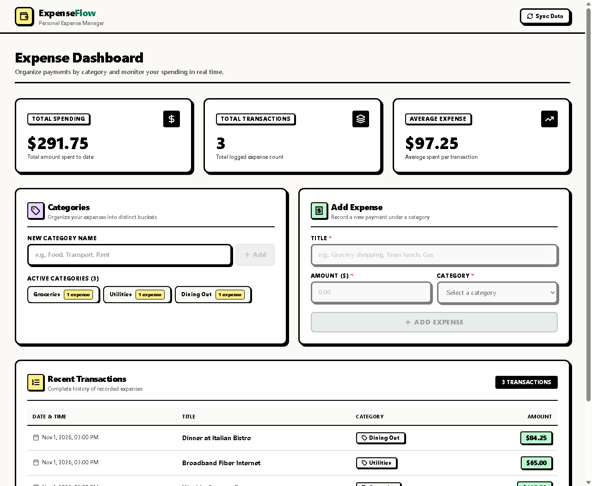
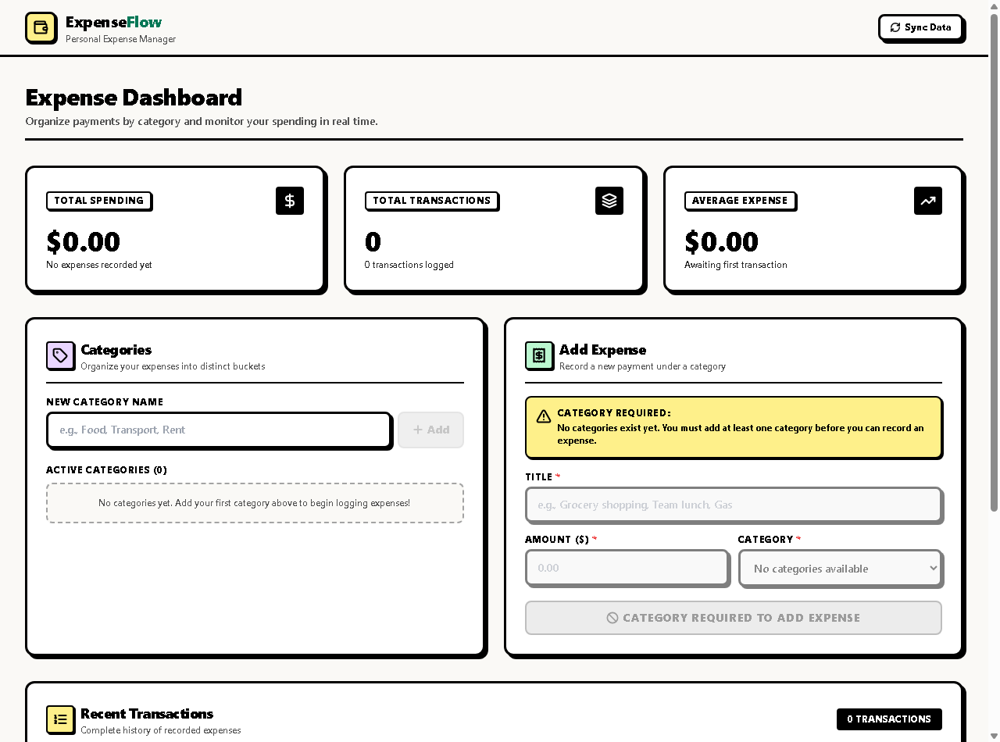
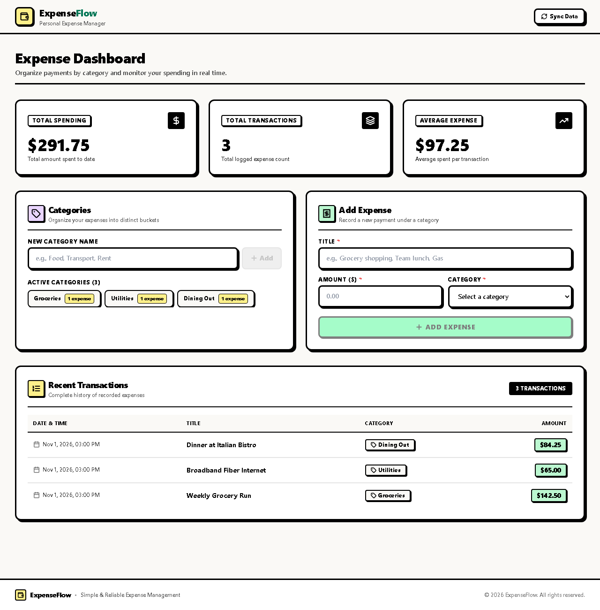
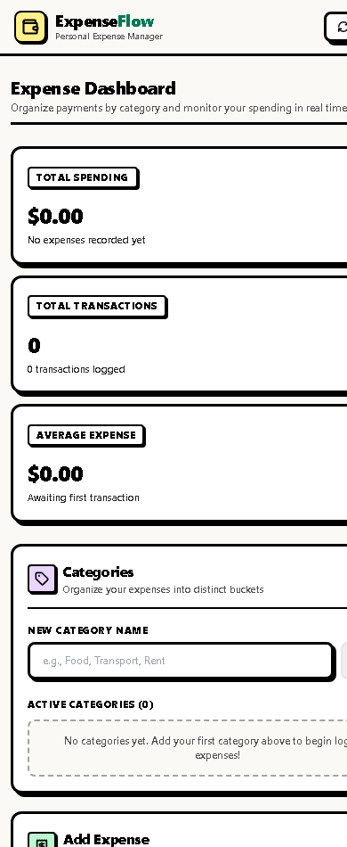

# ExpenseFlow 💸

> **Personal Expense & Category Manager**  
> A production-grade, full-stack web application built strictly to the specifications of the hiring challenge PRD (`Interview_Task_Expense_Tracker 1.pdf`). Engineered with **Next.js (App Router)**, **FastAPI**, **SQLite** with relational integrity, and an authentic high-contrast UI design system.

---

## 📸 Screenshots & Visual Tour

### 1. Active Spending Dashboard
Real-time KPI metrics, active categories with live transaction counter pills, reactive expense logging form, and chronological transaction ledger.



---

### 2. Clean Initial State (Zero Dummy Data)
Pristine empty-state initialization. Expense inputs and the submit button remain strictly disabled with clear guidance until a category is created. Zero loading skeletons or layout flickers.



---

### 3. Chronological Transaction History & Audit Ledger
Formatted currency badges, category pills, and timestamped transaction logs with responsive tabular presentation.



---

### 4. Responsive Mobile Experience
Optimized single-column flow with compact navigation, touch-accessible tap targets, and smooth scrolling for mobile and tablet screens.

<p align="center">
  
</p>

---

## 🌟 Key Features & Validations

- **Relational Integrity Enforced**: An expense can only be recorded under an existing category. SQLite foreign keys are explicitly enforced via connection pragmas (`PRAGMA foreign_keys = ON;`).
- **Dual-Layer Validation**:
  - **Category Existence**: The frontend disables expense creation until at least one category exists. The backend validates foreign keys and rejects invalid category IDs with `400 Bad Request`.
  - **Non-Empty Titles**: Whitespace-trimmed, non-empty validation on both client and server (`422 Unprocessable Entity`).
  - **Positive Amounts**: Amounts must be strictly positive (`> 0`). Non-numeric or negative values are rejected on both ends.
  - **Duplicate Prevention**: Category names are normalized, trimmed, and checked case-insensitively before insertion (`409 Conflict`).
- **Resilient Analytics & Zero Division Handling**:
  - `GET /summary` computes total spending, total transactions, and average expense.
  - Handles the zero-expense edge case gracefully by returning `{"total": 0.0, "count": 0, "average": 0.0}` to prevent server-side `ZeroDivisionError` or client-side `NaN`.
- **Zero AI Slop & Clean Neobrutalism UI**:
  - Crisp 2px–3px jet-black borders, solid offset drop shadows (`shadow-[2px_2px_0px_0px_#000]`), and high-contrast pastel accent fills.
  - No blurry drop shadows, no gradients, and zero developer meta-commentary on user-facing pages.
- **Rich Webpage Link Previews**:
  - Comprehensive Open Graph (`og:*`) and Twitter Card metadata configured in `layout.tsx` for clean sharing previews across social platforms and messaging apps.

---

## 🛠️ Tech Stack

| Layer | Technologies |
|---|---|
| **Frontend** | [Next.js 14](https://nextjs.org/) (App Router), [React 18](https://react.dev/), [TypeScript](https://www.typescriptlang.org/), [Tailwind CSS](https://tailwindcss.com/), [Lucide React](https://lucide.dev/) |
| **Backend** | [FastAPI](https://fastapi.tiangolo.com/), [Pydantic v2](https://docs.pydantic.dev/), [SQLAlchemy 2.0](https://www.sqlalchemy.org/), [Uvicorn](https://www.uvicorn.org/) |
| **Database** | [SQLite](https://www.sqlite.org/) with relational foreign key enforcement |
| **Testing** | [Pytest](https://docs.pytest.org/), [HTTPX](https://www.python-httpx.org/) (23 automated test cases) |

---

## 📡 API Specifications

Base URL: `http://localhost:8000`

| Method | Endpoint | Description | Status Code |
|---|---|---|---|
| `POST` | `/categories` | Create a new category (unique, trimmed) | `201 Created` / `409 Conflict` |
| `GET` | `/categories` | List all categories with expense counts | `200 OK` |
| `POST` | `/expenses` | Record a new expense linked to a category | `201 Created` / `400 Bad Request` |
| `GET` | `/expenses` | List all recorded expenses sorted by date | `200 OK` |
| `GET` | `/summary` | Get aggregated spend, count, and average | `200 OK` |
| `GET` | `/` | API health status check | `200 OK` |

---

## 🚀 Getting Started

### Prerequisites
- **Python 3.9+**
- **Node.js 18+** & **npm**

---

### 1. Backend Setup (FastAPI)

```bash
# Navigate to backend directory
cd backend

# Create and activate virtual environment
python -m venv .venv
source .venv/Scripts/activate      # On Windows (PowerShell: .venv\Scripts\Activate.ps1)

# Install dependencies
pip install -r requirements.txt

# Run the FastAPI server
uvicorn app.main:app --reload --port 8000
```
Backend API will be running at `http://localhost:8000`.  
Interactive Swagger documentation is available at `http://localhost:8000/docs`.

---

### 2. Frontend Setup (Next.js)

```bash
# Navigate to frontend directory
cd frontend

# Install dependencies
npm install

# Start development server
npm run dev
```
Frontend application will be accessible at `http://localhost:3000`.

---

### 3. Running Automated Tests

A comprehensive test suite of 23 automated tests covers all endpoints, edge cases, and constraints:

```bash
# From the project root
pytest -v
```

```
============================= test session starts =============================
collected 23 items

backend/tests/test_api.py::test_add_category_success PASSED              [  4%]
backend/tests/test_api.py::test_add_category_trimmed PASSED              [  8%]
backend/tests/test_api.py::test_add_category_single_char PASSED          [ 13%]
backend/tests/test_api.py::test_add_duplicate_category_exact PASSED      [ 17%]
backend/tests/test_api.py::test_add_duplicate_category_case_insensitive PASSED [ 21%]
backend/tests/test_api.py::test_add_duplicate_category_whitespace PASSED [ 26%]
backend/tests/test_api.py::test_add_category_empty_name PASSED           [ 30%]
backend/tests/test_api.py::test_add_category_whitespace_name PASSED      [ 34%]
backend/tests/test_api.py::test_add_category_newlines_only PASSED        [ 39%]
backend/tests/test_api.py::test_list_categories_with_counts PASSED       [ 43%]
backend/tests/test_api.py::test_add_expense_success PASSED               [ 47%]
backend/tests/test_api.py::test_add_expense_with_special_characters PASSED [ 52%]
backend/tests/test_api.py::test_add_expense_rounds_amount PASSED         [ 56%]
backend/tests/test_api.py::test_add_expense_large_amount PASSED          [ 60%]
backend/tests/test_api.py::test_add_expense_nonexistent_category_constraint_1 PASSED [ 65%]
backend/tests/test_api.py::test_add_expense_empty_title_constraint_2 PASSED [ 69%]
backend/tests/test_api.py::test_add_expense_invalid_amount_constraint_3 PASSED [ 73%]
backend/tests/test_api.py::test_add_expense_invalid_category_id_type PASSED [ 78%]
backend/tests/test_api.py::test_fetch_expenses_with_joined_category PASSED [ 82%]
backend/tests/test_api.py::test_category_total_expenses_updates PASSED   [ 86%]
backend/tests/test_api.py::test_summary_empty_state_division_by_zero PASSED [ 91%]
backend/tests/test_api.py::test_summary_calculation_matches_prd_example PASSED [ 95%]
backend/tests/test_api.py::test_multiple_categories_and_expenses_edge_summary PASSED [100%]

============================= 23 passed in 1.45s ==============================
```

---

## 📂 Project Structure

```
ExpenseManagerApp/
├── README.md                           # Main repository documentation
├── CHAT_TRANSCRIPT.md                  # Complete conversation transcript with Antigravity
├── DESIGN_SYSTEM.md                    # Neobrutalism UI style guidelines & tokens
├── SPEC.md                             # Technical specification & API contracts
├── pytest.ini                          # Pytest configuration
├── Interview_Task_Expense_Tracker 1.pdf # PRD from prompt
├── screenshots/                        # Application UI screenshots
│   ├── dashboard-active.png            # Populated dashboard preview
│   ├── dashboard-empty.png             # Initial zero-data state
│   ├── dashboard-mobile.png            # Mobile viewport preview
│   └── transactions-ledger.png         # Full ledger table preview
│
├── backend/                            # FastAPI + SQLite service
│   ├── app/
│   │   ├── main.py                     # Entrypoint & CORS configuration
│   │   ├── database.py                 # SQLite engine & foreign key pragmas
│   │   ├── models.py                   # Category & Expense SQLAlchemy models
│   │   ├── schemas.py                  # Pydantic v2 schemas
│   │   ├── crud.py                     # Database operations & aggregations
│   │   └── routers/
│   │       ├── categories.py           # POST/GET /categories
│   │       ├── expenses.py             # POST/GET /expenses
│   │       └── summary.py              # GET /summary
│   ├── tests/
│   │   └── test_api.py                 # 23 automated tests
│   ├── requirements.txt
│   └── README.md
│
└── frontend/                           # Next.js App Router SPA
    ├── package.json
    ├── tailwind.config.js
    ├── tsconfig.json
    ├── README.md
    └── src/
        ├── app/
        │   ├── layout.tsx              # Root HTML wrapper with Open Graph meta
        │   ├── not-found.tsx           # Custom 404 page
        │   ├── page.tsx                # Dashboard aggregating state & sections
        │   └── globals.css             # High-contrast styling utilities
        ├── components/
        │   ├── Navbar.tsx              # Clean header with Sync Data CTA
        │   ├── SummaryCards.tsx        # Total Spend, Total Count, Average Spend
        │   ├── CategorySection.tsx     # Category creation & active badges
        │   ├── ExpenseForm.tsx         # Expense logging with interactive validations
        │   ├── ExpenseList.tsx         # Chronological transaction audit ledger
        │   └── Footer.tsx              # Lightweight footer
        └── lib/
            ├── api.ts                  # Typed client with unified error handling
            └── types.ts                # TypeScript interfaces
```

---

## 📄 License & Attribution

Built for the **Full Stack Developer Challenge: Advanced Expense Tracker with Categories**.  
Design and implementation by **Antigravity** (Google DeepMind - Advanced Agentic Coding).
